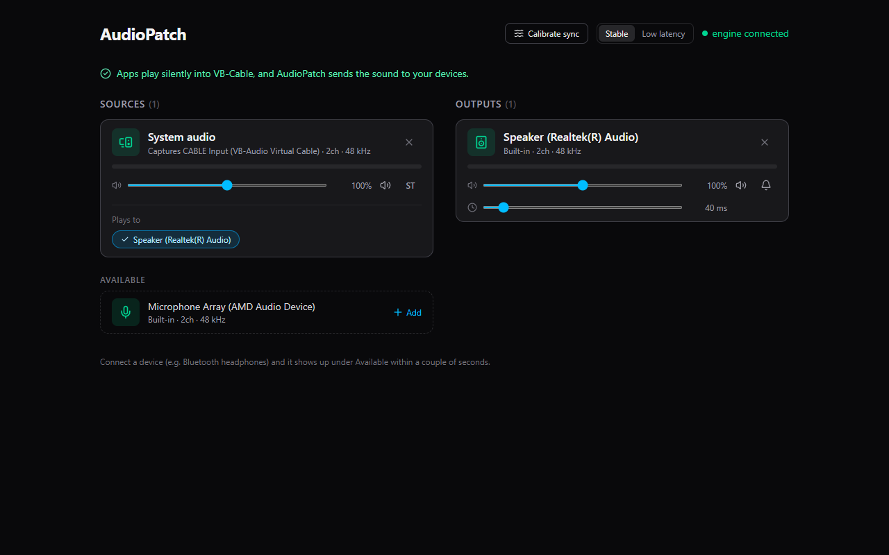
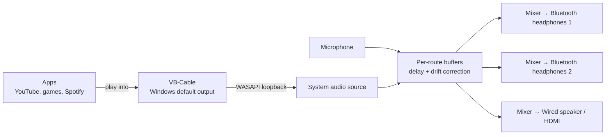

<p align="center">
  
</p>

<h1 align="center">AudioPatch</h1>

<p align="center">
  Play your PC's sound on several headphones and speakers <b>at the same time</b>, wired and Bluetooth,
  with per-device volume and lip-sync correction.
</p>

<p align="center">
  <a href="https://github.com/samay312006/atmos/releases/latest"><b>⬇ Download for Windows</b></a>
  ·
  <a href="#quick-start">Quick start</a>
  ·
  <a href="#troubleshooting">Troubleshooting</a>
</p>



---

## Why

Windows sends sound to **one** output device at a time. If two people want to watch a film on a laptop with
their own Bluetooth headphones, or you want the TV speakers *and* your headphones, you're stuck.

AudioPatch fixes that. It captures everything your PC plays and sends it to as many devices as you like.
Each device gets its own volume, and a delay so a slow Bluetooth headset and a fast wired one stay in sync with each other and with the video.

## What it does

| | |
|---|---|
| 🎧 **Multi-output playback** | Any source to any number of outputs: Bluetooth headphones, USB DACs, the 3.5 mm jack, HDMI/TV audio, laptop speakers. |
| 🔀 **Full routing matrix** | Pick which outputs each source plays to. An output can mix several sources (e.g. system audio plus a mic). |
| 🎚 **Per-device controls** | Volume (0-200%), mute, live level meter, and a **Test sound** chime so you can tell which headphone is which. Sources also get a stereo/mono switch. |
| ⏱ **Lip-sync delay** | A 0-500 ms delay slider on every output to line up devices with different lag. |
| 🎯 **Calibrate sync** | A wizard that plays a chirp through each device, measures its real lag with your laptop mic (or by tapping along), and sets the delays for you. Typically accurate to a few milliseconds. |
| 🕰 **Drift correction** | Every device has its own clock, so over a long movie they'd slowly drift apart. AudioPatch continuously nudges playback speed (by at most 0.3%, which you can't hear) so they never do. |
| 🔌 **Hot-plug** | Devices that connect show up within a couple of seconds. If a device you're using disconnects, it's greyed out, its settings are kept, and audio resumes when it comes back. |
| 🛡 **Feedback protection** | Never plays system audio back into the device it's being captured from (that would echo forever). |
| ⚡ **Stable / Low latency** | Bigger buffers for no dropouts, or smaller ones for less delay. |
| 🖥 **Desktop app** | Runs in its own window, quits when you close it, and remembers your setup. Everything stays on your PC. |

## What it can't do

- **Phones can't do this.** Android and iOS don't let apps capture and redirect system audio to several Bluetooth devices. This is a Windows app (macOS support is experimental, see below).
- **It can't remove Bluetooth lag**, only even it out. Bluetooth headphones typically lag 100-300 ms; AudioPatch delays the *faster* devices to match the slowest one. Video players don't know about that lag, so for perfect lip-sync with Bluetooth you may also want your player's own audio-delay setting (VLC: `J`/`K`; many streaming sites have none).
- **Protected audio**: a few apps that send audio in exclusive mode bypass Windows' mixer and can't be captured.

---

## Quick start

> Tested on **Windows 11**. Windows 10 should work the same way.

### 1. Download

Grab **`AudioPatch-windows-x64.zip`** from the [latest release](https://github.com/samay312006/atmos/releases/latest),
unzip it anywhere (e.g. `Documents\AudioPatch`), and keep the folder together: `AudioPatch.exe` needs the `_internal` folder next to it.

### 2. Install VB-Cable (one time, free, about 3 MB)

AudioPatch needs a "virtual speaker" that apps can play into silently, so it can be the only thing feeding your real devices.
Without it, the device Windows plays to would get the sound twice: once directly, once (delayed) from AudioPatch.

1. Download **VB-Audio Virtual Cable** from <https://vb-audio.com/Cable/> (free, donationware).
2. Extract the zip, right-click **`VBCABLE_Setup_x64.exe`** → **Run as administrator** → **Install Driver**.
3. Restart your PC if the installer asks.

### 3. Run AudioPatch

Double-click **`AudioPatch.exe`**. The first time, Windows may say *"Windows protected your PC"* because the app isn't code-signed:
click **More info → Run anyway**.

The dashboard opens in its own window. If VB-Cable is installed, a blue banner offers
**"Use VB-Cable as Windows output"**. Click it. (Windows sound settings will now show *CABLE Input* as your output; switch back any time.)

### 4. Set up your devices

1. Connect your headphones/speakers. They appear under **Available**.
2. Under **Sources**, click **+ Add** on **System audio**.
3. Under **Outputs**, click **+ Add** on each device you want to hear.
4. Play a video. You should hear it on every output you added.
5. If two devices are out of sync, click **Calibrate sync** (top right).

That's it. AudioPatch remembers this setup next time.

---

## Using AudioPatch

### Sources and outputs

- **Sources** (left) are where sound comes from:
  - **System audio**: everything your PC plays (it captures the Windows default output, i.e. VB-Cable).
  - **Microphones / line-in**: any input device, e.g. to mix a mic into your headphones.
- **Outputs** (right) are where sound goes: every connected speaker, headphone, USB DAC or HDMI device.

Only devices that are connected right now are listed. Paired-but-absent Bluetooth devices are hidden, as are
Bluetooth "Hands-Free" profiles (they switch your headphones to low-quality call mode).

Click **+ Add** to use a device and **✕** to remove it.

### Routing: "Plays to"

Each source card has a **Plays to** row with one chip per output. Click a chip to switch that route on or off.
New sources play to every output, and new outputs receive every source, so you only switch off what you don't want.

An **amber chip with a ⚠** means that route is blocked because it would feed back into itself. That happens when
System audio is captured from that same device, usually because VB-Cable isn't the Windows output yet.

### Per-device controls

| Control | What it does |
|---|---|
| Level meter | Live peak level (green → amber → red near clipping). |
| Volume slider | 0-200%. 100% leaves the sound unchanged. |
| 🔊 Mute | Silences the device without removing it. |
| **ST / M** (sources) | Stereo, or fold down to mono (handy when sharing one earbud each). |
| 🔔 Test sound (outputs) | Plays a short chime on just that device. |
| ⏱ Delay (outputs) | 0-500 ms lip-sync delay. |

### Calibrate sync

Every device has its own lag. The wizard measures it and sets the delay sliders so all devices play together.

1. **Pause any video** and click **Calibrate sync**.
2. Choose how to measure:
   - **Microphone (most accurate):** hold each device right next to your laptop's microphone when asked.
     AudioPatch plays five chirps per device and times them to within a few milliseconds.
   - **Tap along:** press **Space** (or the big Tap button) each time you hear a chirp. Works anywhere,
     accurate to about ±30 ms. Your reaction time cancels out because it's the same for every device.
3. Review the results and click **Apply delays**.

Tips:
- If a device shows "couldn't get a steady reading", turn up its **Windows** volume (the wizard warns you when a
  device is below 15%), hold it closer to the mic, and keep the room quiet.
- The app never uses a Bluetooth headset's own mic for this: opening it would switch the headset into call mode.
- One device on its own has nothing to line up with, but its measured lag is still shown on its card.

### Stable vs Low latency

Top-right toggle. **Stable** (default) keeps about 60 ms of buffer per route, which is robust on busy PCs. **Low latency**
keeps about 20 ms, which means less delay but possible crackles if the PC is under load. Changing it briefly restarts audio.

### When devices come and go

- A newly connected device appears under **Available** within ~2 seconds.
- If a device you're using disconnects, its card turns grey ("Disconnected · resumes when it reconnects") and
  its routing, volume and delay are kept. When it reconnects, audio resumes automatically.
- Connecting a device causes a very short pause (well under a second) while the audio engine refreshes its device list.

### Where your settings live

| What | Where |
|---|---|
| Setup (sources, outputs, routing, volumes, delays) | `%APPDATA%\AudioPatch\session.json` |
| Log file (useful for bug reports) | `%APPDATA%\AudioPatch\audiopatch.log` |

Delete `session.json` to start fresh.

---

## How it works



- **Capture.** System audio is recorded from the default output with WASAPI loopback (via PyAudioWPatch);
  other inputs are opened with PortAudio (`sounddevice`). Everything runs at 48 kHz, 32-bit float.
- **One buffer per route.** Each source writes into a lock-free ring buffer per output it's routed to. Each output
  runs in its own audio callback thread and mixes its buffers, so a slow or failing device can't stall the others.
- **Delay.** An output's latency is how much audio waits in its buffers, so a delay of *N* ms simply means holding
  *N* ms more.
- **Drift correction.** Clocks of different devices differ by up to ~0.02%. A PI controller watches each buffer's
  fill level and resamples by a tiny ratio (≤ ±0.3%) to keep it exactly on target. In tests, ±200 ppm of drift stays
  within 1 ms over minutes of playback.
- **Calibration.** A 120 ms frequency sweep is played per output and located in the microphone recording with a matched
  filter (sub-millisecond precision). The mic is opened in WASAPI *raw* mode: laptop mic arrays otherwise apply echo
  cancellation that erases the chirps and adds variable delay. Five chirps per device; the result counts only if most
  of them agree within 8 ms.
- **Resilience.** Device errors are caught per stream and shown on the device card; the engine never crashes because a
  device vanished. Hot-plug is detected by watching Windows' list of active audio endpoints.
- **UI.** A local web server (FastAPI) serves a React dashboard and streams levels at ~30 Hz over a WebSocket.
  It only listens on `127.0.0.1`, so nothing is reachable from your network and nothing is sent anywhere.

---

## Run from source

Requirements: **Windows 10/11**, **Python 3.11+**, **Node.js 18+**.

```powershell
git clone https://github.com/samay312006/atmos.git
cd atmos
python -m venv .venv
.venv\Scripts\pip install -r requirements-dev.txt
python run.py
```

`run.py` builds the dashboard on first run (`npm install` + `npm run build`), starts the engine and opens
<http://127.0.0.1:8765> in your browser. It automatically re-launches itself inside `.venv`, so a plain `python run.py` works.

Options:

| Flag | Effect |
|---|---|
| `--app` | Open in an app window and quit when it's closed (the exe's behaviour) |
| `--no-browser` | Don't open anything (e.g. for API use) |
| `--port 9000` | Use another port (default 8765) |
| `--rebuild` | Force a rebuild of the dashboard |

For frontend work with hot reload, run `python run.py --no-browser` and, in another terminal,
`cd frontend && npm run dev`. Vite proxies the API and WebSocket to the backend.

### Build the Windows app yourself

```powershell
.venv\Scripts\python build_exe.py
```

This rebuilds the dashboard and runs PyInstaller with [`audiopatch.spec`](audiopatch.spec). The result is
`dist\AudioPatch\AudioPatch.exe` (a ~67 MB folder; zip the whole `dist\AudioPatch` folder to share it).

### Tests

```powershell
.venv\Scripts\python -m pytest
```

63 tests, no audio hardware needed. They cover the mixer, ring buffer, resampler, delay buffer, drift correction
(simulated clock mismatch), calibration signal detection, routing persistence, device classification and the HTTP API.

### Project layout

```
backend/
  engine/
    devices.py       device discovery, type detection (Bluetooth/USB/HDMI/…), hot-plug watcher
    ringbuffer.py    lock-free single-producer/single-consumer buffer
    resampler.py     streaming linear resampler (sample-rate conversion)
    mixer.py         sources, outputs, per-route delay + drift control, test tones
    streams.py       PortAudio / WASAPI-loopback stream wrappers (never raise in callbacks)
    engine.py        turns the saved setup into running streams; calibration control
    calibration.py   chirp, matched-filter detection, consensus, delay suggestions
    routing.py       the user's setup (sources, outputs, routes, params), saved to JSON
  api/app.py         REST + WebSocket server
frontend/            React + TypeScript + Tailwind dashboard (Vite)
tests/               pytest suite
run.py               launcher (dev and packaged)
build_exe.py         one-command Windows build
audiopatch.spec      PyInstaller configuration
assets/              app icon (+ the script that generates it)
```

### HTTP API

The dashboard is a thin client over a small local API, so you can script AudioPatch too
(base URL `http://127.0.0.1:8765`):

| Method | Path | Body | |
|---|---|---|---|
| GET | `/api/devices` | | connected devices (`?all=true` for every known device) |
| GET | `/api/routing` | | current setup |
| GET | `/api/engine` | | running streams, errors, feedback-blocked routes |
| POST | `/api/sources`, `/api/outputs` | `{"id"}` | add a device |
| POST | `/api/sources/remove`, `/api/outputs/remove` | `{"id"}` | remove a device |
| POST | `/api/routes` | `{"source","output","on"}` | switch a route |
| POST | `/api/params` | `{"id","volume"?,"muted"?,"mono"?,"delay_ms"?}` | device settings |
| POST | `/api/outputs/test` | `{"id"}` | play the test chime |
| POST | `/api/engine/mode` | `{"mode":"stable"\|"low"}` | buffer mode |
| POST | `/api/calibrate/start` | `{"mode":"mic"\|"tap","outputs"?}` | start calibration |
| POST | `/api/calibrate/apply` | | apply the last calibration |
| WS | `/ws` | | live `devices`, `routing`, `engine`, `levels`, `calibration` events |

---

## Troubleshooting

**I hear the sound twice / with an echo.**
Windows is still playing directly to one of your devices *and* AudioPatch is sending to it. Make VB-Cable the
Windows output (the blue banner's button, or Windows Settings → System → Sound → Output → *CABLE Input*).

**I hear nothing.**
- Is **System audio** added as a source, with its **Plays to** chips switched on (blue)?
- Is the output muted, or is its Windows volume at 0? Click the 🔔 test sound to check the device itself.
- Is the System audio meter moving while something plays? If not, check that Windows' output is *CABLE Input*.
- If you switched Windows' output back to your headphones, either use AudioPatch again or remove the headphones from AudioPatch.

**A chip is amber with ⚠.**
That route would feed System audio back into the device it's captured from. Switch Windows' output to VB-Cable.

**Crackles or dropouts.**
Use **Stable** mode. Bluetooth is sensitive to Wi-Fi interference on 2.4 GHz and to distance, so move closer. Very busy
PCs (games, video encoding) may need fewer outputs.

**My two headphones are slightly out of sync.**
Run **Calibrate sync**, or nudge the faster device's delay slider up a few ms at a time until they line up.

**Calibration says "couldn't get a steady reading".**
Turn the device's Windows volume up, hold it right against the laptop mic, keep the room quiet, and try again.
Or use **Tap along**.

**A device doesn't appear.**
Make sure it's connected in Windows (Settings → Bluetooth & devices) and shows up in Windows' sound output list.
For Bluetooth headphones, use the device called *Headphones (…)*, not *Headset (… Hands-Free)*.

**Windows protected your PC.**
The exe isn't code-signed. Click **More info → Run anyway**, or build it yourself from source.

**The window closed but sound keeps playing.**
AudioPatch shuts down about 8 seconds after its window closes, so a page reload doesn't kill it. If it's still
running, end **AudioPatch** in Task Manager. When it isn't running, remember to switch Windows' output back to your
speakers/headphones, or you'll hear nothing (everything is going into VB-Cable).

**Something else.**
Check `%APPDATA%\AudioPatch\audiopatch.log` and open an issue with it attached.

---

## macOS (experimental)

The engine has a macOS path: it uses [BlackHole](https://existential.audio/blackhole/) (`brew install blackhole-2ch`)
in place of VB-Cable, and the dashboard shows a setup guide if it's missing. It has **not been tested yet** and there's
no packaged Mac build. Run it from source and please report what happens.

## Roadmap

- Drag-and-drop patchbay with animated cables, background spectrum visualiser
- Presets ("Movie night: 2 headphones", "Party: all speakers"), themes, cinematic mode, panic (mute all) button, keyboard shortcuts
- 3-band EQ per output
- Audio file playback as a source
- Tested macOS build

## Credits

Built with [FastAPI](https://fastapi.tiangolo.com/), [sounddevice](https://python-sounddevice.readthedocs.io/) / PortAudio,
[PyAudioWPatch](https://github.com/s0d3s/PyAudioWPatch) (WASAPI loopback), [pycaw](https://github.com/AndreMiras/pycaw),
NumPy, React, Vite, Tailwind CSS, Framer Motion and lucide icons. Virtual audio device:
[VB-Audio Virtual Cable](https://vb-audio.com/Cable/) (not bundled; free download from VB-Audio).
