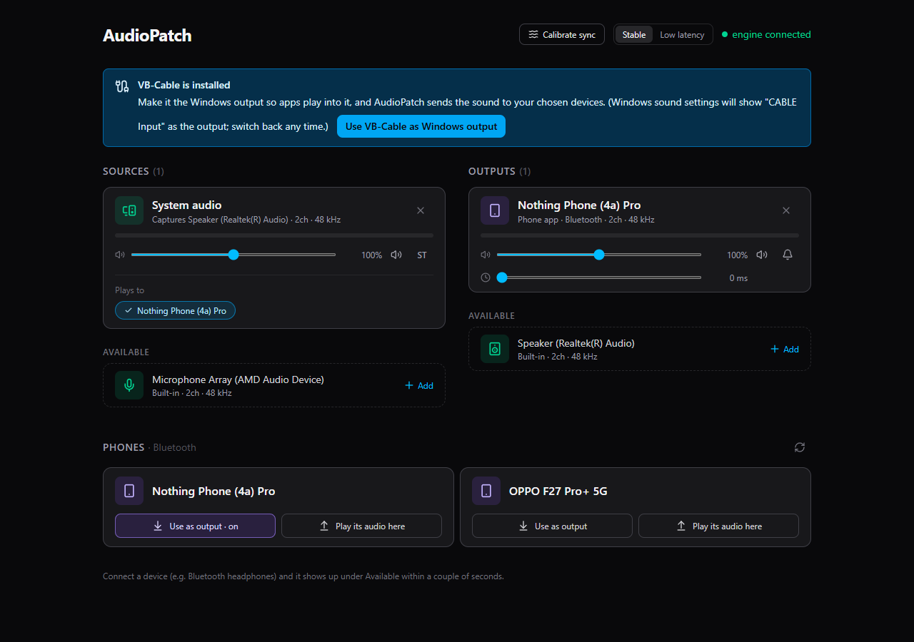
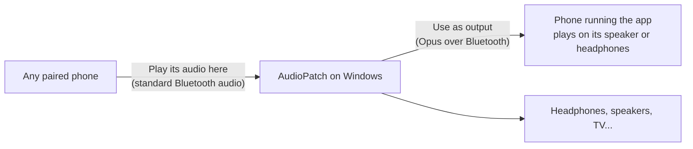

<p align="center">
  
</p>

<h1 align="center">AudioPatch</h1>

<p align="center">
  Play your PC's sound on several headphones and speakers <b>at the same time</b>, wired and Bluetooth,
  with per-device volume and lip-sync correction. Phones can join over Bluetooth.
</p>

<p align="center">
  <a href="https://github.com/samay312006/atmos/releases/latest"><b>⬇ Download for Windows</b></a>
  ·
  <a href="apps/desktop#quick-start">Quick start</a>
  ·
  <a href="apps/android">Android app</a>
</p>



---

## Why

Windows sends sound to **one** output device at a time. If two people want to watch a film on a laptop with
their own Bluetooth headphones, or you want the TV speakers *and* your headphones, you're stuck.

AudioPatch captures everything your PC plays and sends it to as many devices as you like, each with its own volume
and a delay so a slow Bluetooth headset and a fast wired one stay in sync with each other and with the video.
It measures each device's lag for you with your laptop's microphone.

## What's in this repo

| App | What it does | Status | Get it |
|---|---|---|---|
| **[Windows](apps/desktop)** | The router: system audio and mics to any number of outputs, routing matrix, volume, lip-sync delay, drift correction, sync calibration, hot-plug. Plus phones over Bluetooth. | ✅ Released | [Download](https://github.com/samay312006/atmos/releases/latest) |
| **[Android](apps/android)** | **Wireless output**: the phone plays the PC's sound (on its speaker or its own headphones). **Send to PC**: the phone's sound plays through the PC. **Router**: phone audio on several of its outputs. | 🚧 In development: Wireless output and Send to PC work, Router is next | [Build from source](apps/android#build-and-install-from-source); APK coming with the first Android release |

### Phones and the PC, over Bluetooth



- **Use as output** needs the Android app. One more listener per phone, with its own volume and delay.
- **Play its audio here** needs nothing on the phone: the PC acts as a Bluetooth speaker for it and passes the
  sound on to all your outputs. It works with every app.

The protocol and the measurements behind its design are in [docs/bluetooth-link.md](docs/bluetooth-link.md).

## Quick start (Windows)

1. Download **`AudioPatch-windows-x64.zip`** from the [latest release](https://github.com/samay312006/atmos/releases/latest) and unzip it.
2. Install the free [VB-Audio Virtual Cable](https://vb-audio.com/Cable/) (once, about 3 MB).
3. Run **`AudioPatch.exe`**, click **Use VB-Cable as Windows output**, add **System audio** as a source and your
   headphones/speakers as outputs.

Full guide, troubleshooting and the local API: **[apps/desktop/README.md](apps/desktop/README.md)**.

## Repository layout

```
apps/
  desktop/     Windows app: Python audio engine + React dashboard (README inside)
  android/     Android app: Kotlin + Jetpack Compose (README inside)
docs/
  bluetooth-link.md   PC <-> phone protocol, shared by both apps
  *.png               screenshots and icon
```

Each app builds and tests on its own:

| | Run / build | Tests |
|---|---|---|
| Desktop | `cd apps/desktop` → `python run.py` / `python build_exe.py` | `python -m pytest` (71 tests) |
| Android | `cd apps/android` → `./gradlew assembleDebug` | `./gradlew testDebugUnitTest` (8 tests) |

## What it can't do

- **It can't remove Bluetooth lag**, only even it out by delaying the faster devices. A phone used as an output adds
  about 300 ms on top of its own headphones' lag.
- **Phones alone** play to only one Bluetooth headset at a time (some newer phones can share audio with several LE
  Audio earbuds through the system settings). AudioPatch's phone features work together with a Windows PC.
- **Protected audio** that bypasses Windows' mixer (exclusive mode) can't be captured.

## Credits

Desktop: FastAPI, sounddevice/PortAudio, PyAudioWPatch, pycaw, PyWinRT, libopus (via PyOgg), NumPy, React, Vite,
Tailwind CSS, Framer Motion, lucide. Android: Kotlin, Jetpack Compose, Android MediaCodec.
Virtual audio device: [VB-Audio Virtual Cable](https://vb-audio.com/Cable/) (not bundled).
